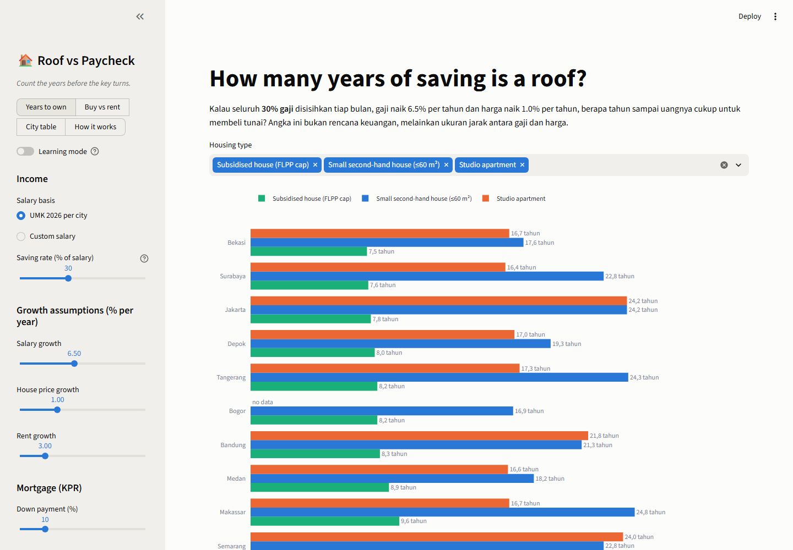
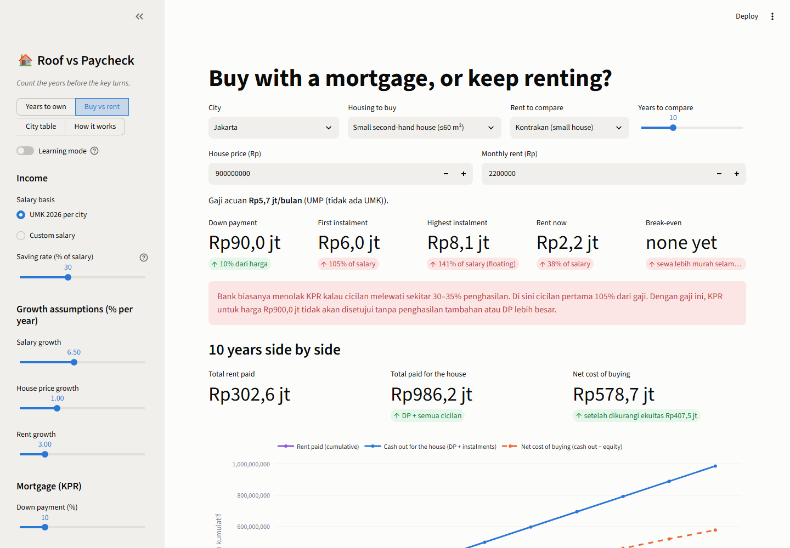
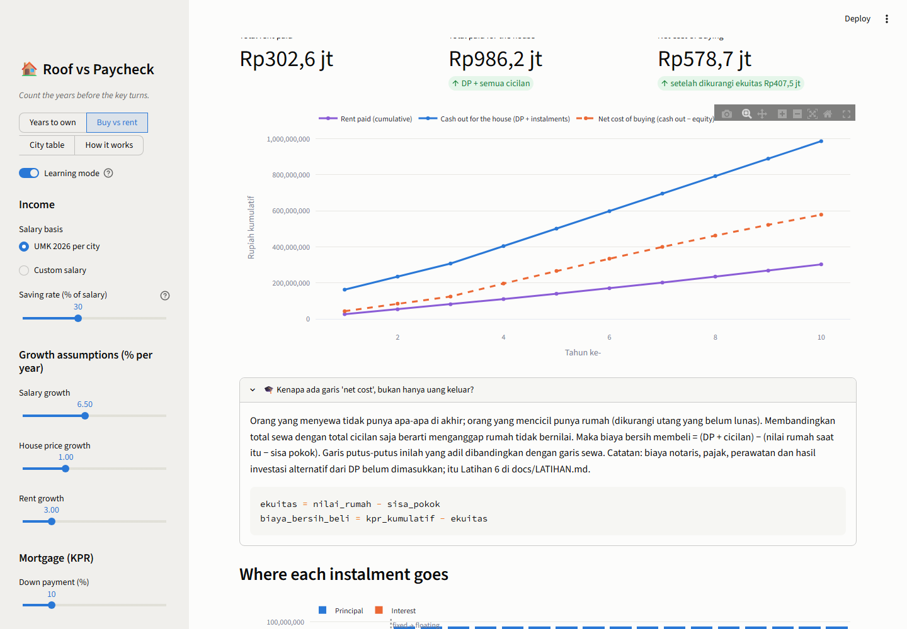
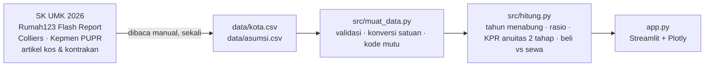

# 🏠 Roof vs Paycheck

> **Count the years before the key turns.**
> Dashboard yang menyandingkan upah minimum 2026 di 13 kota Indonesia dengan harga rumah subsidi,
> rumah seken kecil, apartemen studio, kos, dan kontrakan di kota yang sama. Berapa tahun menabung
> untuk satu atap, dan apakah mencicil lebih masuk akal daripada menyewa?
> Dibangun dengan Python, pandas, Plotly, dan Streamlit.

*Puts the 2026 minimum wage of 13 Indonesian cities next to the price of a roof in the same city
(subsidised house, small second-hand house, studio apartment, boarding room, rented house), counts
the years of saving each one takes, and runs an honest buy-vs-rent calculation with a two-stage
mortgage. Data collected once from published reports, with a confidence grade on every number.
Built with Python, pandas, Plotly and Streamlit.*

**🚀 Coba langsung di browser:** [roof-vs-paycheck.streamlit.app](https://roof-vs-paycheck.streamlit.app)



## Kenapa project ini ada?

"Anak muda sekarang tidak akan pernah bisa beli rumah" adalah kalimat yang sering diucapkan dan
jarang dihitung. Project ini menghitungnya, kota per kota, dengan angka yang bisa dilacak sumbernya:

1. **Berapa tahun gaji** yang setara dengan harga satu atap di tiap kota (price-to-income ratio)?
2. Kalau 30% gaji ditabung dan gaji naik tiap tahun, **berapa tahun sampai bisa beli tunai**?
3. Kalau pakai KPR, **berapa persen gaji** yang habis untuk cicilan, dan apa yang terjadi saat bunga
   tetap berakhir?
4. Selama 10 tahun, **lebih murah menyewa atau mencicil**, setelah nilai rumah yang terbentuk ikut dihitung?

Tidak ada scraping. Semua angka dikumpulkan sekali dari SK upah minimum, Rumah123 Flash Report,
Colliers, Kepmen PUPR dan artikel properti, lalu disimpan di `data/kota.csv` dengan **kode mutu**
A sampai E supaya pembaca tahu angka mana yang kokoh dan mana yang perkiraan.

## Fitur

| Page | Isi |
|---|---|
| 📊 Years to own | Grafik batang tahun menabung per kota untuk rumah subsidi, rumah seken ≤60 m², dan studio; grafik rasio harga ÷ gaji setahun dengan garis "5× = sangat tidak terjangkau" |
| 🏦 Buy vs rent | Pilih kota, hunian, jenis sewa, dan horizon tahun. Kartu DP, cicilan pertama, cicilan tertinggi (setelah bunga mengambang), sewa sekarang, titik impas. Grafik kumulatif sewa vs uang keluar vs biaya bersih membeli, dan komposisi bunga/pokok tiap tahun |
| 📋 City table | Semua angka mentah dengan kode mutu, catatan per kota, download CSV |
| 🧭 How it works | Alur data, definisi, daftar keterbatasan, asumsi awal |
| 🎓 Learning mode | Toggle di sidebar: tiap bagian mendapat penjelasan konsep + potongan kode |

Sidebar: gaji (UMK per kota atau angka sendiri), porsi nabung, laju kenaikan gaji / harga / sewa,
dan parameter KPR (DP, tenor, bunga tetap, masa tetap, bunga mengambang). Semua asumsi awal ada
di `data/asumsi.csv` beserta sumbernya.




## Cara menjalankan

```bash
git clone https://github.com/Avalon2222/roof-vs-paycheck.git
cd roof-vs-paycheck
python -m venv .venv && source .venv/bin/activate   # Windows: .venv\Scripts\activate
pip install -r requirements.txt
streamlit run app.py
```

Buka `http://localhost:8501`. Jalankan tes dengan `python -m pytest tests/ -v`. Tes yang sama otomatis jalan di GitHub Actions setiap push dan pull request.

Memperbarui data: ubah `data/kota.csv` atau `data/asumsi.csv` dan catat sumbernya di
`data/SUMBER_DATA.md`. Tidak ada skrip unduh, karena tidak ada API publik untuk angka-angka ini.

## Cara kerja (ringkas)



Inti perhitungannya:

```python
rasio   = harga / (gaji * 12)                                   # berapa tahun gaji penuh
tahun   = tahun_menabung(harga, gaji, porsi=30, kenaikan_gaji=6.5, kenaikan_target=1.0)
cicilan = pokok * r / (1 - (1 + r) ** -n)                       # anuitas; dihitung ulang saat bunga berubah
bersih  = (dp + cicilan_kumulatif) - (nilai_rumah - sisa_pokok)  # biaya bersih membeli, adil dibanding sewa
```

Penjelasan lengkap di [docs/BELAJAR.md](docs/BELAJAR.md).

## Temuan dari dataset tersimpan

Asumsi awal: nabung 30% gaji, gaji naik 6,5%/tahun, harga naik 1%/tahun, KPR DP 10%, tenor 20 tahun,
bunga tetap 6,5% tiga tahun lalu mengambang 11%.

- **Rumah subsidi masih terjangkau di atas kertas.** Dengan UMK, batas harga FLPP (Rp166-185 juta)
  setara 2,6-5,4 tahun gaji; menabung 30% butuh 7,5 tahun di Bekasi sampai 13,4 tahun di Surakarta.
  Cicilan KPR-nya 21-43% dari UMK di bulan pertama. Di Jabodetabek, Surabaya dan Bandung, pekerja
  UMK *lajang* memang bisa diterima bank untuk rumah subsidi.
- **Rumah seken kecil di dalam kota adalah cerita lain.** Median rumah ≤60 m² setara **7,4 tahun
  gaji di Bogor sampai 19,5 tahun di Yogyakarta**. Menabung 30% UMK butuh 17 tahun (Bogor) sampai
  30 tahun (Yogyakarta). Rasio 5× yang dianggap "sangat tidak terjangkau" terlampaui di semua kota.
- **KPR rumah seken tidak akan disetujui dengan UMK di kota mana pun.** Cicilan pertama 60% dari UMK
  di Bogor, 105% di Jakarta, 157% di Yogyakarta. Supaya cicilan pertama 30% gaji, dibutuhkan
  Rp9,6 juta/bulan di Medan sampai Rp20 juta/bulan di Jakarta, dan saat bunga mengambang mulai di tahun
  ke-4, angka itu naik lagi sepertiga.
- **Kota murah belum tentu terjangkau.** Yogyakarta, Surakarta dan Denpasar punya harga rumah "hanya"
  Rp500-800 juta, tetapi UMK-nya Rp2,6-3,5 juta, jadi rasionya justru yang terburuk. Bekasi dan Bogor
  punya kombinasi terbaik: UMK tinggi, rumah pinggiran relatif murah.
- **Sewa memakan 18-60% UMK.** Kos standar 16% (Bogor) sampai 41% (Denpasar) dari UMK; kontrakan
  1-2 kamar 18% (Bogor) sampai 60% (Denpasar). Itu sebelum makan dan transport.
- **Dalam 10 tahun, menyewa hampir selalu lebih murah secara kas,** tetapi garis *net cost* (setelah
  dikurangi ekuitas rumah) menyempit tiap tahun. Dengan kenaikan harga 1%/tahun titik impas jarang
  tercapai di 10 tahun; geser slider ke 5%/tahun dan ceritanya berbalik. Asumsi kenaikan harga adalah
  angka paling menentukan di seluruh dashboard, dan sengaja ditaruh di tangan pembaca.

Angka berubah kalau slider digeser atau CSV diperbarui, dan memang itu tujuannya.

## Struktur folder

```
roof-vs-paycheck/
├── app.py                     # dashboard Streamlit (tampilan)
├── src/
│   ├── muat_data.py           # baca + validasi CSV, konversi satuan
│   └── hitung.py              # tahun menabung, rasio, KPR anuitas, beli vs sewa
├── data/
│   ├── kota.csv               # 13 kota: UMK 2026, harga rumah/apartemen, kos, kontrakan, kode mutu
│   ├── asumsi.csv             # nilai awal slider + sumbernya
│   └── SUMBER_DATA.md         # tautan dan catatan tiap angka
├── tests/                     # pytest, tanpa internet
└── docs/
    ├── BELAJAR.md             # panduan 9 langkah
    ├── LATIHAN.md             # 8 latihan bertingkat
    └── screenshots/
```

## Keterbatasan

- **Harga iklan, bukan transaksi.** Median Rumah123 adalah harga yang diminta penjual; harga deal
  biasanya lebih rendah beberapa persen.
- **Beberapa angka adalah perkiraan (kode E).** Untuk Jakarta, Semarang, Yogyakarta, Medan dan
  Denpasar, segmen ≤60 m² diturunkan dari segmen lain dengan rasio kota Bodetabek. Kolom kontrakan
  paling lemah dari semua.
- **UMK bukan gaji tipikal.** Ini batas bawah. Masukkan gaji sendiri lewat *Custom salary*.
- **Biaya kepemilikan lain belum dihitung:** BPHTB, notaris, asuransi, perawatan, dan imbal hasil
  kalau DP diinvestasikan. Latihan 6 membahasnya.
- **Bukan saran keuangan.** Ini alat untuk melihat jarak antara gaji dan harga, bukan rencana KPR.

## Lisensi

MIT. Sumber data tercantum di `data/SUMBER_DATA.md`; hak atas laporan asli tetap pada penerbitnya.
